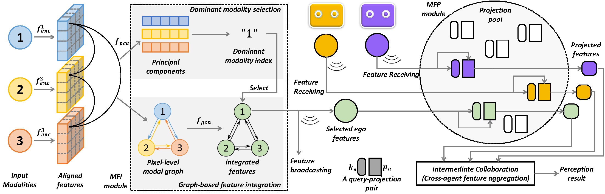

# DisCo
Facilitating Heterogeneous Sensor Information Cooperation in Multi-Agent Perception System [[DOI]](https://doi.org/10.1016/j.ins.2026.123529)

Accepted by **Information Sciences** on Apr.16, 2026.

## Overview

**Abstract:** Collaboration addresses the fundamental limitations of single-agent perception systems by enabling information exchange. However, most existing approaches rely on simplified assumptions, requiring agents to use either identical multi-modal sensors or distinct yet single modalities. Such assumptions limit real-world applicability, where agents often operate with flexible, heterogeneous sensor suites. Furthermore, in dynamically changing networks where agents may freely join or exit, existing methods frequently exhibit significant performance degradation or even integration failure. To overcome these challenges, we propose DisCo, a novel two-stage distributed paradigm for robust perception under arbitrary intra-agent modality variations and dynamic inter-agent network changes. In DisCo, each agent first learns independently to fuse its own sensor set, and then learns to align these heterogeneous features into a unified collaboration space. We instantiate DisCo with two core modules: a Multi-modal Feature Integration (MFI) module for within-agent fusion, and a Multi-agent Forward Projection (MFP) module, which implements the feature alignment via a lightweight projection pool that dynamically adapts to network changes. Extensive experiments demonstrate that DisCo achieves leading performance across diverse collaborative scenarios, and successfully maintains robustness to agent joining and exiting, as well as modality changes.


## Updates
- 2026/XX/XX Release the trained weights (Coming soon).
- 2026/11/12 Release the code.
- 2026/04/14 Create project.


## Features

- Dataset Support
  - [x] DAIR-V2X
  - [x] OPV2V

- Spconv Support
  - [x] 1.2.1
  - [x] 2.x

- Encoding support
  - [x] Camera: EfficientNet + LiftSplat
  - [x] Camera: EfficientNet + Unprojection
  - [x] LiDAR: PointPillars
  - [x] LiDAR: SECOND

- Visualization
  - [x] BEV visualization
  - [x] 3D visualization


## Download dataset 
#### 1. OPV2V
1. Download raw data of [OPV2V](https://ucla.app.box.com/v/UCLA-MobilityLab-OPV2V) relseased by Official.

#### 2. DAIR-V2X
1. Download raw data of [DAIR-V2X](https://drive.google.com/drive/folders/1gnrw5llXAIxuB9sEKKCm6xTaJ5HQAw2e).
2. Download complemented annotation from [Yifan Lu](https://github.com/yifanlu0227/CoAlign).


## Install
Please refer to the [INSTALL.md](./INSTALL.md) for detailed documentations. 


## Train the Disco  model
The setting is same as OpenCOOD, which uses yaml file to configure all the parameters for training. To train your own model from scratch or a continued checkpoint, run the following commonds:
```python
python opencood/tools/train.py --hypes_yaml ${CONFIG_FILE} [--model_dir  ${CHECKPOINT_FOLDER}]
```
Arguments Explanation:
- `hypes_yaml`: the path of the training configuration file, e.g. `opencood/hypes_yaml/second_early_fusion.yaml`, meaning you want to train
an early fusion model which utilizes SECOND as the backbone. See [Tutorial 1: Config System](https://opencood.readthedocs.io/en/latest/md_files/config_tutorial.html) to learn more about the rules of the yaml files.
- `model_dir` (optional) : the path of the checkpoints. This is used to fine-tune the trained models. When the `model_dir` is given, the trainer will discard the `hypes_yaml` and load the `config.yaml` in the checkpoint folder.

### 1: Train encoder network
Train each networks who participates the collaboration. They are located in `single` and `multimodal` of `opencood/hypes_yaml/opv2v` and `opencood/hypes_yaml/dair-v2x`.

For example, to train `pointpillar` on OPV2V from scratch:
```
python opencood/tools/train.py --hypes_yaml opencood/hypes_yaml/opv2v/opv2v_single_pillar.yaml
```

To train `pointpillar + liftsplat` on DAIR-V2X from scratch:
```
python opencood/tools/train.py --hypes_yaml opencood/hypes_yaml/dair-v2x/multimodal/dair_multi_pillar_liftsplat.yaml
```

### 2: Train collaboration network
Train the networks collaborated by different encoding methods.

For example, to train the collaboration between `pointpillar + liftsplat(Agent1)` + `second + unprojection (Agent2)` on DAIR-V2X from scratch:
```
python opencood/tools/train_disco.py --hypes_yaml opencood/hypes_yaml/dair-v2x/hetero/dair_disco_pl+su.yaml
```

Specify the following parameters first before training:
- `origin_hypes`: for loading encoder weights.
- `model_path`: for loading encoder weights.
- `origin_fusion_uid`: loading the agent id in training stage 1. Often `a1`.
- `fusion_mode`: support `implicit` and `explicit`, which are the designs of DisCo.
- `freeze_fusion` Freeze each encoding networks. Need to set as `True`.
- `fusion_channel`: Should be consistent between encoding modules and collabotation modules.


## Test the DisCo model
First make sure the `validation_dir` in config.yaml under checkpoint folder, e.g. `opv2v/test`.

```python
python opencood/tools/inference.py --model_dir ${CHECKPOINT_FOLDER} --fusion_method ${FUSION_STRATEGY} --save_vis ${default False}
```
Arguments Explanation:
- `model_dir`: the path to your saved model.
- `fusion_method`: indicate the fusion strategy, currently support 'early', 'late', 'intermediate', 'no'(indicate no fusion, single agent), 'intermediate_with_comm'(adopt intermediate fusion and output the communication cost).
- `save_vis`: bool. Wether to save the visualization result.

The evaluation results  will be dumped in the model directory.


## Acknowledgements
Thank for the excellent cooperative perception codebases [OpenCOOD](https://github.com/DerrickXuNu/OpenCOOD) and [Where2comm](https://github.com/MediaBrain-SJTU/Where2comm).

Thank for the excellent cooperative perception datasets [OPV2V](https://mobility-lab.seas.ucla.edu/opv2v/) and [DAIR-V2X](https://thudair.baai.ac.cn/index).

Thank for the dataset and code support by [DerrickXu](https://github.com/DerrickXuNu), [Yue Hu](https://github.com/MediaBrain-SJTU) and [YiFan Lu](https://github.com/yifanlu0227).
